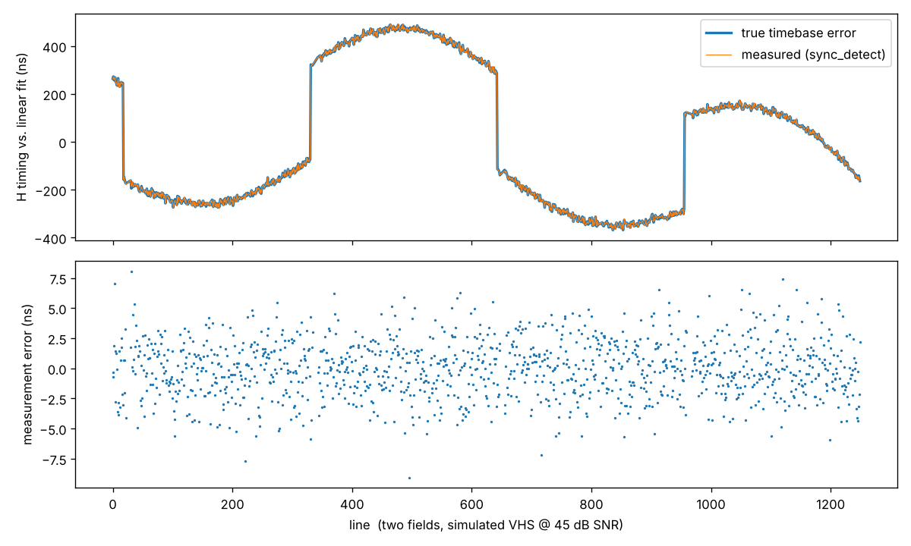

# Clacktronics TBC

An FPGA time base corrector for PAL composite video: MS9280 10-bit ADC (AD9280 also fits) → Gowin GW2AR-18 (Tang Nano 20K).

The plan is the one from the design discussion:

1. Sample with a free-running 27 MHz clock (1728 samples per line).
2. Measure every line's sync to a fraction of a sample.
3. Decode to Y/U/V.
4. Resample each line onto a stable grid.
5. Frame-buffer into the SDRAM, and send out on a clean clock.

## Status: stage 1, sync measurement

| block | file | state |
|---|---|---|
| PAL signal synthesiser with VHS-like timebase errors | `py/pal.py` | done |
| sync detector model (bit-exact reference) | `py/sync_model.py` | done |
| sync detector RTL | `rtl/sync_detect.v`, `rtl/div_frac.v` | done, matches model bit-exactly |
| MS9280/AD9280 interface + clamp drive | `rtl/adc_if.v` | written, untested on hardware |
| UART edge logger + host plot tool | `rtl/event_logger.v`, `py/uart_capture.py` | done (sim) |
| Tang Nano 20K top + pins | `rtl/top.v`, `constraints/tangnano20k.cst` | builds |
| line PLL / timing tracker | | next |
| Y/C separation + U/V demod | | |
| polyphase line resampler | | |
| SDRAM frame buffer, HDMI out | | |

### What the sync detector does

The input is first smoothed with a [1 2 1] filter. A 50% slicer with hysteresis then follows the sync tip and blanking levels it measures from the signal, so input gain and offset don't need trimming.

Each edge's position comes from linear interpolation of the 50% crossing, giving an 8-bit fraction of a sample (one small divide per edge). The pulse width classifies each pulse as equalising, hsync or broad, and glitches are rejected. Odd/even field is worked out from where the first broad pulse falls.

Each line produces both the leading and the trailing edge. The midpoint of the two is the most precise timing reference.

Simulated results, from `make eval` (σ after removing the constant filter delay):

| scenario | lead σ | trail σ | midpoint σ |
|---|---|---|---|
| clean, VHS timebase | 0.53 ns | 0.51 ns | 0.38 ns |
| 45 dB SNR, VHS timebase | 2.35 ns | 2.52 ns | 1.75 ns |
| 38 dB SNR, VHS timebase | 5.17 ns | 5.50 ns | 3.84 ns |

One sample is 37 ns, so this is roughly 1/15 to 1/100 of a sample. The simulated VHS error has a ±1 µs slow wander, 25 Hz drum flutter, 10 ns per-line jitter and a 400 ns head-switch step. Every pulse was classified correctly in every scenario.



## Quick start

Install the [OSS CAD Suite](https://github.com/YosysHQ/oss-cad-suite-build). It provides yosys, nextpnr-himbaechel, apicula's `gowin_pack`, iverilog and openFPGALoader. You also need Python 3 with `numpy scipy matplotlib` (and `pyserial` for the board).

```sh
make eval        # score the detector, writes build/sync_eval.png
make sim         # RTL vs model, bit-exact        -> "PASS"
make sim-top     # whole design incl. UART stream -> "PASS"
make bitstream   # -> build/top.fs
make prog        # load to SRAM (make flash to keep it)
python3 py/uart_capture.py /dev/tty.usbserial-XXXX --seconds 5 --plot jitter.png
```

`make sim` takes about 10 s and `make bitstream` about 2 minutes. Current usage is 1.5k of 20.7k LUTs, and timing closes at 118 MHz against the 27 MHz needed.

## Hardware hookup (stage 1)

The carrier board is in `hardware/tbc_carrier` (KiCad 10). The Tang Nano 20K plugs into two 1×20 2.54 mm sockets on it, USB-C end towards header pin 1.

| signal | FPGA pin | header pin | MS9280 | AD9280 |
|---|---|---|---|---|
| `adc_clamp` | 73 | 1 | CLAMP | CLAMP |
| `adc_clk` | 74 | 2 | CLK | CLK |
| `adc_otr` | 75 | 3 | OTR | OTR |
| `adc_d[9]` | 85 | 4 | D9 | D7 |
| `adc_d[8]` | 77 | 5 | D8 | D6 |
| `adc_d[7:1]` | 27, 28, 25, 26, 29, 30, 31 | 8–14 | D7…D1 | D5…D0, NC |
| `adc_d[0]` | 52 | 21 | D0 | NC |
| `uart_tx` | 69 (onboard USB-UART) | – | – | – |

The MS9280's top 8 bits sit on the pins an AD9280 uses for D7–D0, so either part fits. With an AD9280, `adc_d[1:0]` read 0 (the FPGA pulls them down). The sync detector uses `adc_d[9:2]`, so code values below are 8-bit.

The data bits run down the header in ADC pin order, so the board tracks fan out without crossing. All ADC lines except `adc_d[0]` are on the left header row, and `adc_d[0]` goes round the end of the socket to pin 21. Header pins 6–7 and 15–18 are the onboard LEDs, and FPGA pins 32–40 don't reach the header (33–40 drive HDMI). Pins 73–77 and 25–31 also go to the LCD FPC connector, so don't fit an LCD at the same time. FPGA 41, 42 and 48 carry the REF IN syncs, and spare IOs 49, 71, 72, 76 and 86 are brought out to J3 (along with the REF syncs).

What's on the board:

- RCA input, ESD diode, then a 5th-order 75 Ω Butterworth LC low-pass: flat through chroma, −3 dB at 6 MHz, about −35 dB at 13.5 MHz. It ends in the 75 Ω termination (solder jumper JP1, which you can open for loop-through).
- CBM8051N buffer (Corebai, a drop-in for the OPA355) on a filtered 5 V supply, gain 1.5 and biased at 2 V. 1 V of video becomes 1.5 V at the ADC, about 192 codes per volt.
- MS9280 (LCSC C1509021, about $1.55; a pin-compatible 10-bit AD9280) in top/bottom mode with a 2 V span (AIN 0–2 V), AC-coupled through 22 Ω and 1 µF so its built-in clamp works. CLAMPIN is 0.60 V from a divider on VREF, so blanking sits near code 77. AVDD comes from an LP5907 LDO, and DRVDD from the Tang Nano's 3V3.
- 33 Ω series resistors on every digital line, test points, an expansion header and M3 holes.

The PCB has all parts placed with GND pours on both sides, but it isn't routed yet. The RCA footprint was drawn from Same Sky's RCJ-04x drawing, so check it against the jack you buy before ordering.

Front-end notes:

- `adc_clamp` is high on the back porch after the burst, so it drives the ADC's built-in clamp directly.
- The model assumes about 200 codes per volt: sync tip near code 16, blanking near 76, white near 216. Because the slicer self-calibrates, ±20% is fine.
- If captured data looks noisy, try `ADC_CLK_INVERT=1` in `top.v`. That changes the capture phase relative to the ADC's output delay, which is up to 25 ns against a 37 ns clock.

LEDs (active low):

| LED | meaning |
|---|---|
| 0 | sync present |
| 1 | 1 Hz blink at field rate |
| 2 | ADC clipping |
| 3 | field id |
| 4 | UART overflow |
| 5 | in sync pulse |

## UART stream

The UART runs at 115200 8N1. Each packet is 10 bytes: `A5 flags lead[31:0] trail[31:0]`.

- The timestamps are 24.8 fixed point, in samples.
- One hsync in every 32 is sent, counted from the start of each field, plus a marker packet per field.
- `py/packets.py` decodes the stream, and `py/uart_capture.py` prints and plots the per-field timebase wander. On a VCR, that wander is exactly what the TBC has to remove.

## Layout

```
rtl/          synthesisable Verilog
sim/          iverilog testbenches (vectors/ and out/ are generated)
py/           signal synthesis, bit-exact models, scoring, host tools
constraints/  Tang Nano 20K pin file
hardware/     KiCad carrier board (front end + ADC)
docs/         images
```
